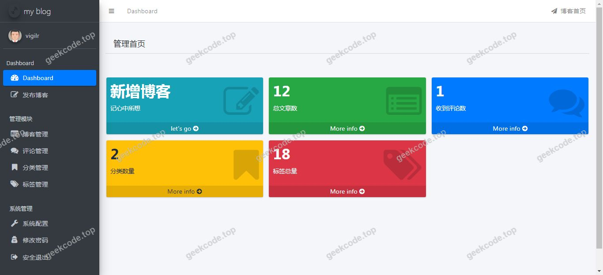
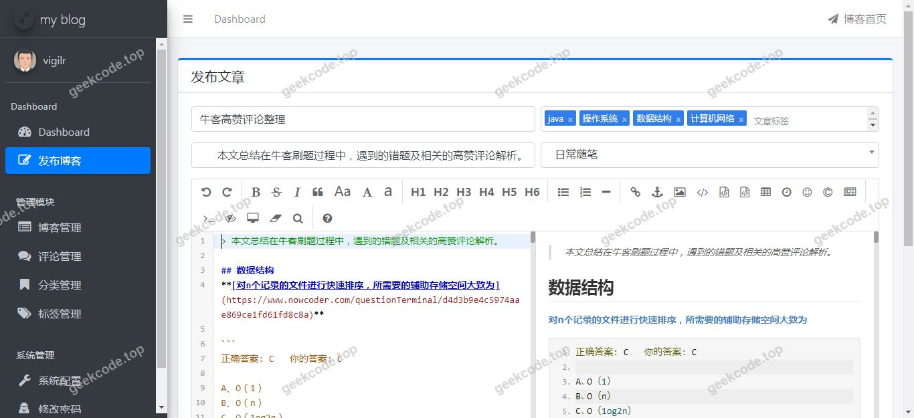
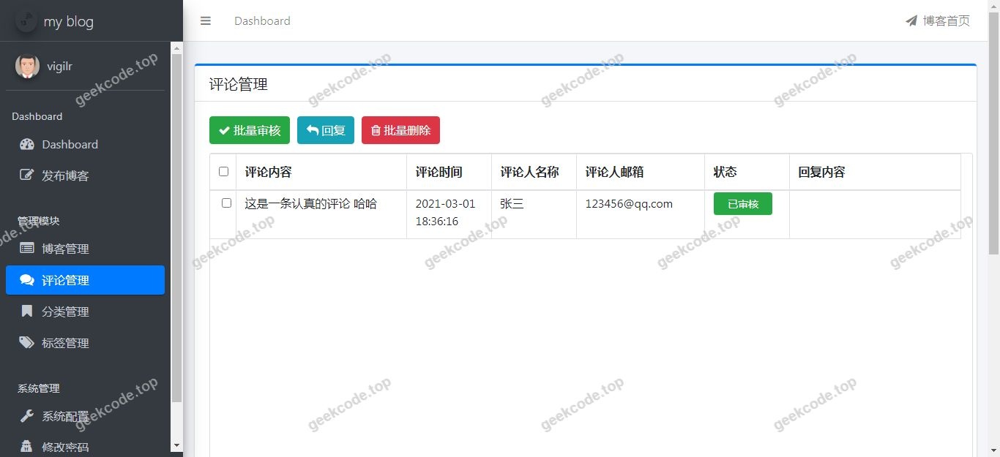
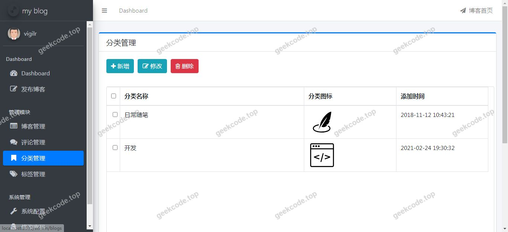
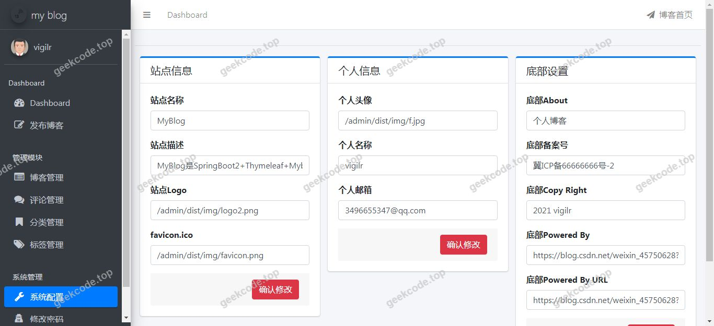

# java精品项目-基于ssm个人博客系统

> 🎓 **计算机毕业设计 · java精品项目-基于ssm个人博客系统**
>
> 本仓库只放**项目介绍 + 运行截图**（截图是站点带水印的原图，存在仓库 `images/` 里）。
>
> 👉 **完整可运行源码 / 数据库脚本 / 部署文档：[点我获取](https://geekcode.top/archives/java%E7%B2%BE%E5%93%81%E9%A1%B9%E7%9B%AE-%E5%9F%BA%E4%BA%8Essm%E4%B8%AA%E4%BA%BA%E5%8D%9A%E5%AE%A2%E7%B3%BB%E7%BB%9F?utm_source=github)**
>
> 💬 咨询微信：**ir9372**　|　🌐 更多项目：[极客代码 geekcode.top](https://geekcode.top/?utm_source=github)
>
> 📌 项目详情页：<https://geekcode.top/archives/java%E7%B2%BE%E5%93%81%E9%A1%B9%E7%9B%AE-%E5%9F%BA%E4%BA%8Essm%E4%B8%AA%E4%BA%BA%E5%8D%9A%E5%AE%A2%E7%B3%BB%E7%BB%9F?utm_source=github>

<table><td width="230" align="center"> <b>扫码加微信 ir9372</b></td><td valign="middle">📦 源码 = 项目介绍 + 全部运行截图 + 数据库 + 部署文档 👉 点上方任意截图，直接跳到 <b>极客代码 geekcode.top</b> 详情页</td></table>

---

<h1>java精品项目-基于ssm个人博客系统</h1>
<h2>项目概述</h2>

本项目名为“java精品项目-基于ssm个人博客系统”，旨在构建一个轻量级、高性能的个人博客平台。项目核心目标是实现内容的快速发布、展示与管理，适用于个人创作者进行技术分享或生活记录。尽管项目名称提及SSM（Spring, Spring MVC, MyBatis），但根据实际依赖配置，底层框架已升级为 Spring Boot 生态体系，以简化配置并提升开发效率。系统采用前后端一体化架构，后端负责业务逻辑与数据持久化，前端通过 Thymeleaf 模板引擎渲染页面。适用人群主要为计算机专业学生、独立开发者及需要简易内容管理系统的个人用户。技术架构上，结合 MySQL 数据库存储博客数据，利用 Kaptcha 实现验证码功能，引入 Commonmark 库支持 Markdown 语法解析，确保内容展示的灵活性与规范性。

<h2>技术架构</h2>

本项目采用基于 Java 语言的单体应用架构，具体技术选型如下：

<ol>
<li><strong>后端框架</strong>：使用 <code>spring-boot-starter-web</code> 作为基础 Web 容器，提供 RESTful API 及静态资源服务能力；集成 <code>mybatis-spring-boot-starter</code> 实现 ORM 映射，简化数据库操作；引入 <code>spring-session-core</code> 管理分布式会话状态，增强安全性。</li>
<li><strong>前端渲染</strong>：采用 <code>spring-boot-starter-thymeleaf</code> 作为服务端模板引擎，实现 HTML 页面的动态生成与数据绑定，避免前后端分离带来的跨域问题，适合中小型博客系统。</li>
<li><strong>数据存储</strong>：使用 <code>mysql-connector-java</code> 连接 MySQL 数据库，存储用户信息、文章内容及评论数据。</li>
<li><strong>辅助组件</strong>：</li>
</ol>
<ul>
<li><code>kaptcha</code>：用于生成图形验证码，防止恶意注册或暴力破解。</li>
<li><code>commonmark</code> 及 <code>commonmark-ext-gfm-tables</code>：用于将 Markdown 文本转换为 HTML，支持表格等扩展语法，提升内容编辑体验。</li>
</ul>
<ol start="5">
<li><strong>测试工具</strong>：包含 <code>spring-boot-starter-test</code>，支持单元测试与集成测试，保障代码质量。</li>
</ol>
<h2>功能模块</h2>

根据提供的截图列表及依赖配置，系统主要包含以下功能模块：

<h3>前台用户端</h3>
<ul>
<li><strong>博客首页展示</strong>：显示最新发布的文章列表、标题及摘要，提供直观的导航入口。</li>
<li><strong>文章详情页</strong>：完整展示文章内容，支持 Markdown 格式渲染，包括代码高亮、表格显示等。</li>
<li><strong>系统运行界面交互</strong>：涵盖多个关键视图（对应截图中的界面1至7），可能包括登录页、注册页、个人中心、文章编辑器预览等核心交互场景。</li>
<li><strong>验证码校验</strong>：在涉及敏感操作（如登录、注册）时，展示 Kaptcha 生成的图形验证码以验证用户身份。</li>
</ul>
<h3>后台管理端</h3>
<ul>
<li><strong>注意</strong>：根据提供的上下文信息，“是否有后台: 否”且无后台路由描述，因此本项目未明确包含独立的后台管理系统界面。若存在管理员功能，推测可能集成在前台特定权限视图中或通过直接操作数据库/配置文件进行管理，具体细节根据现有信息无法确定。</li>
</ul>
<h2>用户角色与权限</h2>

由于项目元数据显示“是否有前台: 否”、“是否有后台: 否”且无具体路由定义，同时截图仅标注为“系统运行界面 (front)”，这表明系统可能处于演示阶段或未完全区分角色权限界面。基于常见博客系统及现有依赖推断：

<ul>
<li><strong>游客（未登录用户）</strong>：</li>
<li>可访问功能：浏览博客首页、查看文章详情、阅读评论内容。</li>
<li>不可访问功能：发布文章、修改个人信息、删除内容。</li>
<li><strong>注册用户（普通作者）</strong>：</li>
<li>可访问功能：登录/注册（需通过 Kaptcha 验证）、撰写并发布新文章、编辑自己发布的文章、管理个人资料。</li>
<li>依据：Commonmark 依赖暗示了富文本/Markdown 编辑能力，通常面向有创作需求的用户。</li>
<li><strong>管理员</strong>：</li>
<li>根据现有信息无法确定是否存在独立的管理员角色及其具体权限范围。若无显式后台，可能不存在传统意义上的超级管理员界面，或所有用户均视为同等权限的个人博主。</li>
</ul>
<h2>项目特色与创新点</h2>
<ol>
<li><strong>Markdown 原生支持</strong>：通过集成 <code>commonmark</code> 库，系统允许用户使用标准的 Markdown 语法编写博客内容，并自动渲染为美观的 HTML，极大提升了技术类文章的排版效率和专业度。</li>
<li><strong>安全机制内嵌</strong>：引入 <code>Kaptcha</code> 验证码组件，在关键交互环节提供人机识别保护，增强了系统的抗攻击能力，符合毕业设计对安全性的基本要求。</li>
<li><strong>轻量化架构设计</strong>：摒弃复杂的前后端分离架构，采用 Thymeleaf 服务端渲染模式，减少了网络请求开销，部署简单，适合个人服务器或小规模应用场景。</li>
<li><strong>标准化开发流程</strong>：基于 Spring Boot 起步依赖，实现了“约定优于配置”，降低了环境搭建难度，便于后续功能的扩展与维护。</li>
</ol>
<h2>部署环境</h2>

为确保项目正常运行，需准备以下软件环境：

<ol>
<li><strong>Java 运行环境</strong>：JDK 1.8 及以上版本（推荐 JDK 8 或 JDK 11，以兼容 Spring Boot 主流版本）。</li>
<li><strong>数据库服务</strong>：MySQL 5.7 或 MySQL 8.0 版本，需创建对应的数据库实例及表结构。</li>
<li><strong>构建工具</strong>：Maven 3.6+ 或 Gradle，用于依赖管理和项目打包。</li>
<li><strong>Web 服务器</strong>：内置 Tomcat（由 spring-boot-starter-web 提供），无需额外安装外部 Servlet 容器。</li>
<li><strong>浏览器</strong>：Chrome、Firefox 或 Edge 等现代浏览器，用于访问前端页面。</li>
<li><strong>其他依赖</strong>：无需 Node.js 或微信开发者工具，因为项目采用纯 Java 后端加 Thymeleaf 模板方案，不涉及前端工程化构建或小程序开发。</li>
</ol>
<h2>六、功能模块截图</h2>
<h3>前台用户端</h3>
<h4>系统运行界面1</h4>

<h4>系统运行界面2</h4>

<h4>系统运行界面3</h4>

<h4>系统运行界面4</h4>

<h4>系统运行界面5</h4>

<h4>系统运行界面6</h4>

<h4>系统运行界面7</h4>

---

## 获取完整源码

| 项目 | 说明 |
| --- | --- |
| 项目名 | java精品项目-基于ssm个人博客系统 |
| 运行截图 | 本文 7 张（站点带水印原图，仓库 `images/` 目录） |
| 完整源码 | [https://geekcode.top/archives/java%E7%B2%BE%E5%93%81%E9%A1%B9%E7%9B%AE-%E5%9F%BA%E4%BA%8Essm%E4%B8%AA%E4%BA%BA%E5%8D%9A%E5%AE%A2%E7%B3%BB%E7%BB%9F?utm_source=github](https://geekcode.top/archives/java%E7%B2%BE%E5%93%81%E9%A1%B9%E7%9B%AE-%E5%9F%BA%E4%BA%8Essm%E4%B8%AA%E4%BA%BA%E5%8D%9A%E5%AE%A2%E7%B3%BB%E7%BB%9F?utm_source=github) |
| 咨询微信 | **ir9372**（备注：jingpin-yuanma） |
| 更多项目 | [极客代码 geekcode.top](https://geekcode.top/?utm_source=github) |

> 需要源码、部署、改配置、跑不起来等问题，加微信 ir9372 沟通，说明项目名即可。
